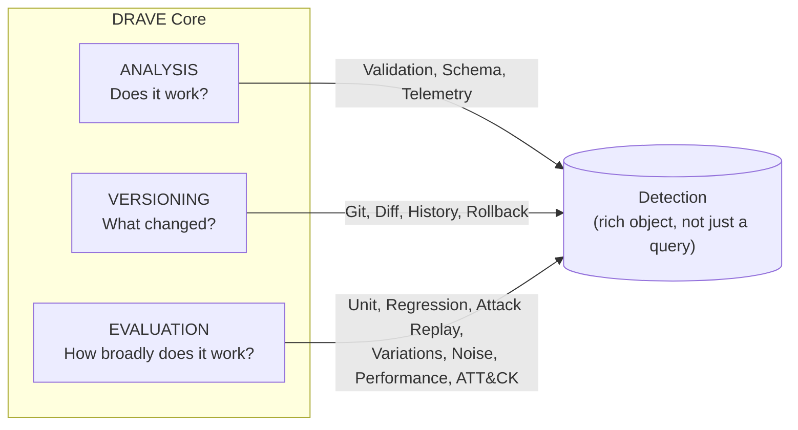
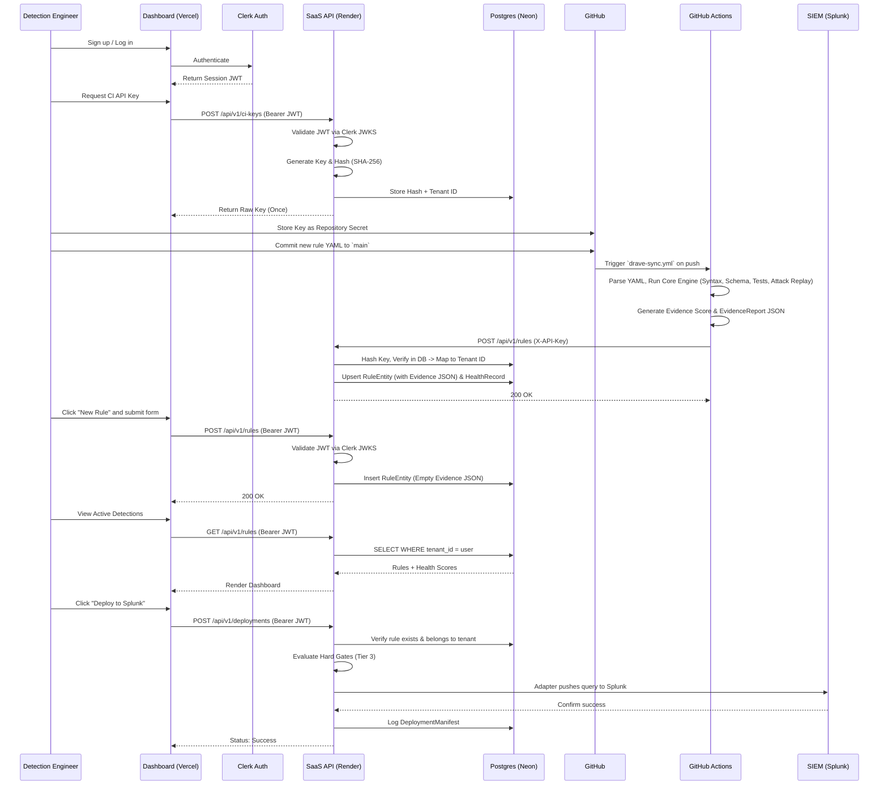
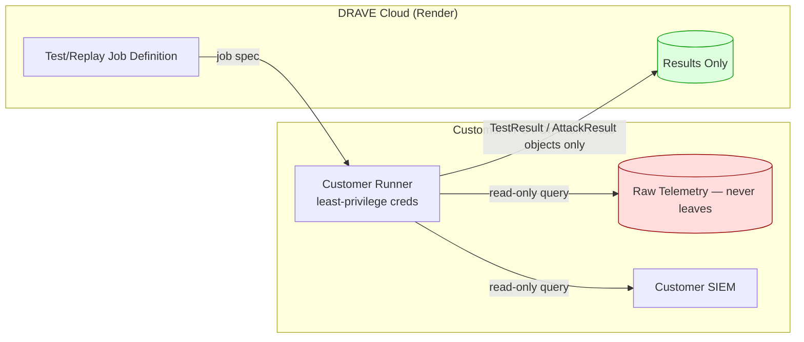
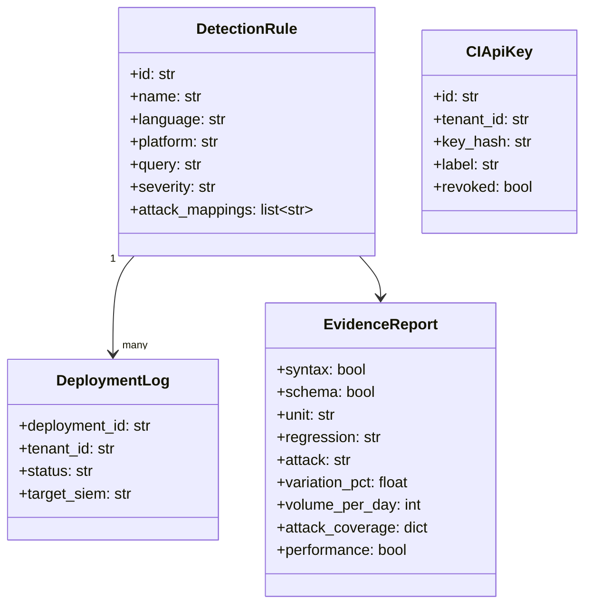
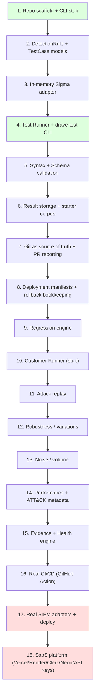

# DRAVE — Architecture Reference

**Purpose:** single source-of-truth diagram set for DRAVE's system architecture, data model, lifecycle, and trust boundaries. Give this file to an AI coding agent alongside `AGENTS.md` and `DRAVE-Approval-Policy.md` — it's the "shape of the system" doc; those are the "rules of engagement" docs.

Companion docs: `DRAVE-Knowledge-Base.md` (concepts), `DRAVE-Build-Blueprint.md` (build order/tech stack), `DRAVE-Tech-Stack-Decisions.md` (detailed rationale), `AGENTS.md` + `DRAVE-Approval-Policy.md` (agent behavior rules).

---

## 1. System Architecture (Component View)

```mermaid
flowchart TB
    subgraph Users["Detection Engineers"]
        GH[GitHub / GitLab]
        WEB[Web Dashboard (Vercel)]
    end

    subgraph Auth["Identity"]
        CLERK[Clerk Auth]
    end

    WEB -->|JWT| API
    CLERK -.->|JWKS Validation| API
    WEB -.->|Login| CLERK

    subgraph GitHubActions["CI/CD Automation"]
        CI[DRAVE CI]
        SYNC[API Sync Workflow]
    end
    
    GH -->|Push/PR| CI
    CI -->|Score/Validation| SYNC
    SYNC -->|X-API-Key| API

    subgraph CloudHosting["Render Cloud"]
        API["DRAVE API (FastAPI)"]
        ORCH[Pipeline Orchestrator]
        
        API --> ORCH
        
        subgraph Orchestration
            ORCH --> RM[Rule Management]
            ORCH --> TE[Test Engine]
            ORCH --> DEP[Deployment]
        end
    end

    subgraph Database["Neon Serverless DB"]
        NEON[(PostgreSQL)]
    end
    
    API -->|SQLModel| NEON
    RM -->|Save Rules| NEON

    subgraph TestEngine["Test Engine"]
        TE --> UNIT[Unit Tests]
        TE --> REPLAY[Attack Replay]
        TE --> REGR[Regression]
    end

    UNIT --> EVID[Evidence Engine]
    REPLAY --> EVID
    REGR --> EVID
    RM --> EVID

    EVID --> HEALTH[Health Engine]
    HEALTH --> GATE{Hard Gates}
    GATE -->|PASS| DEP
    GATE -->|WARN| DEP
    GATE -->|FAIL| BLOCK[Block / Fix Rule]

    DEP --> ADAPT[SIEM Adapters]
    ADAPT --> SPLUNK[Splunk]
    ADAPT --> SENTINEL[Sentinel]

    ORCH --> RUNNER[Customer Runner]
    RUNNER --> TELEM[Customer Telemetry]
    RUNNER --> SIEM[Customer SIEM]

    style GATE fill:#f9d,stroke:#900
    style BLOCK fill:#f99,stroke:#900
    style RUNNER fill:#dfd,stroke:#090
    style NEON fill:#bbf,stroke:#33f
    style CLERK fill:#fbf,stroke:#f3f
```

**Key boundary:** everything inside `RUNNER` down runs inside **customer infrastructure**. Only results (not raw telemetry) cross back to DRAVE Cloud.

---

## 2. DRAVE Core — Three Pillars, One Object



---

## 3. Real End-to-End Lifecycle Sequence

This sequence diagram illustrates the entire flow of data across the real production systems (Vercel, Clerk, Render, Neon, GitHub Actions) from user signup through rule creation, CI validation, API sync, and deployment.



---

## 4. Trust Boundary — Customer Telemetry



**Rule for any agent building this:** if a code path would send raw telemetry (not a `TestResult`/`AttackResult` object) from `runner/` back to `api/`, that is a Tier 3 action under the Approval Policy — stop and ask.

---

## 5. Data Model (Core Objects)



---

## 6. Build-Order Overlay (which layer to build when)


Green = safe to build/run entirely locally. Red = touches real production systems — governed by `DRAVE-Approval-Policy.md` Tier 3.
