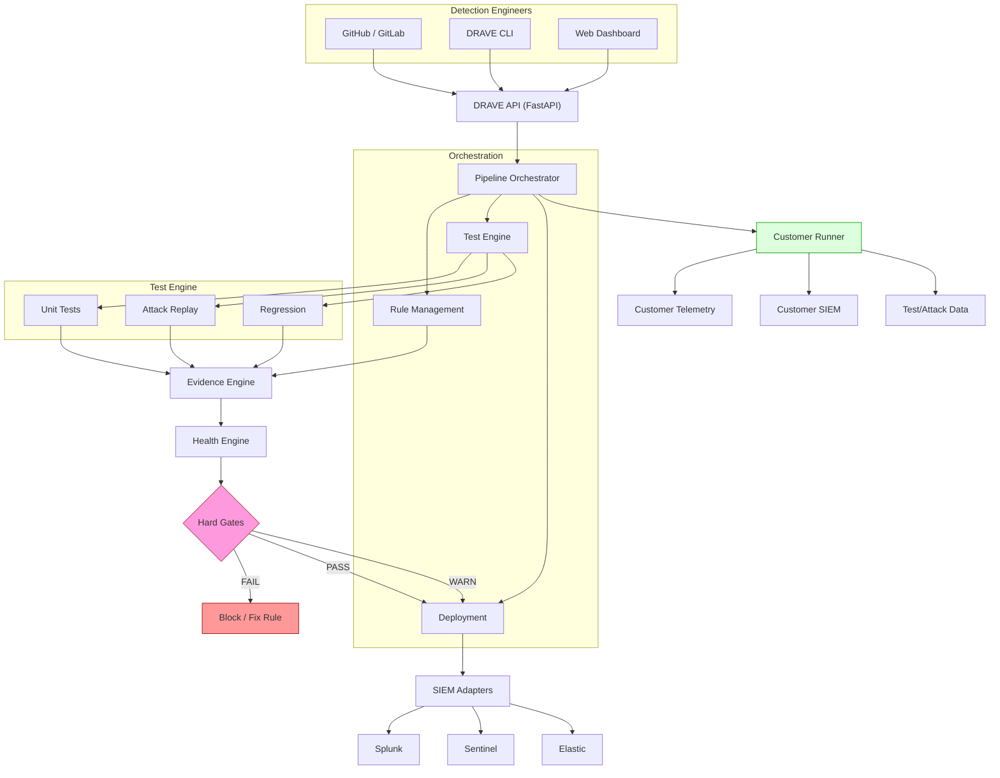
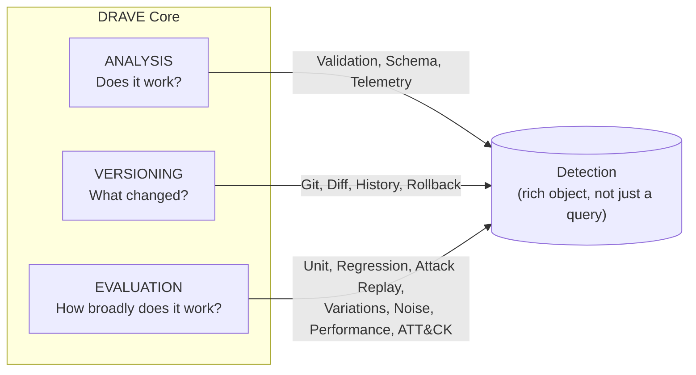
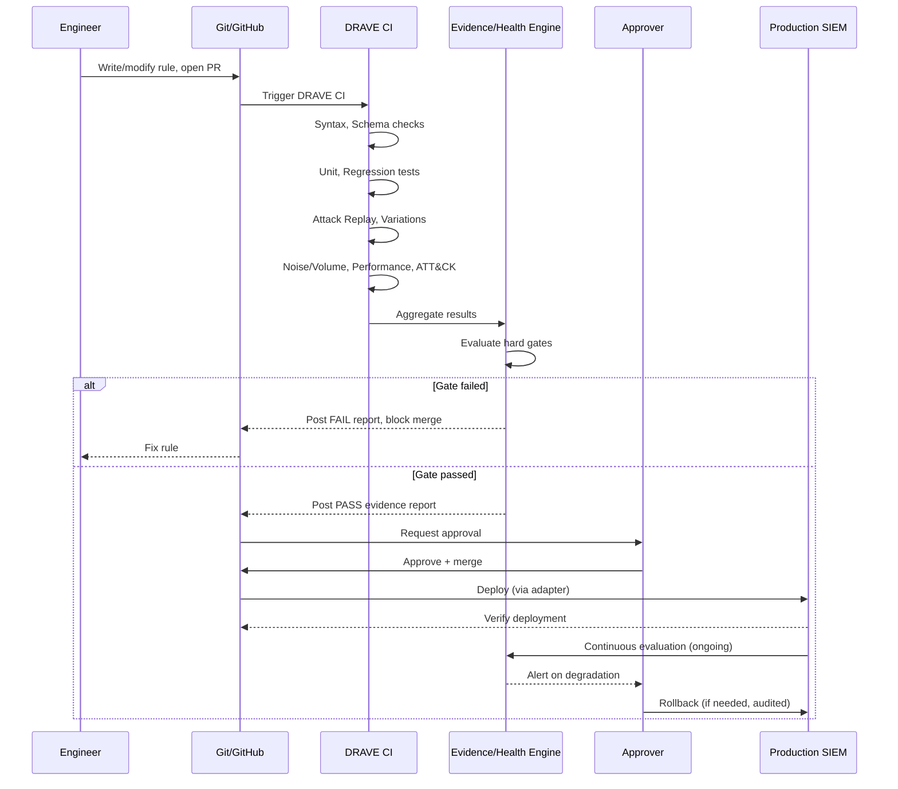
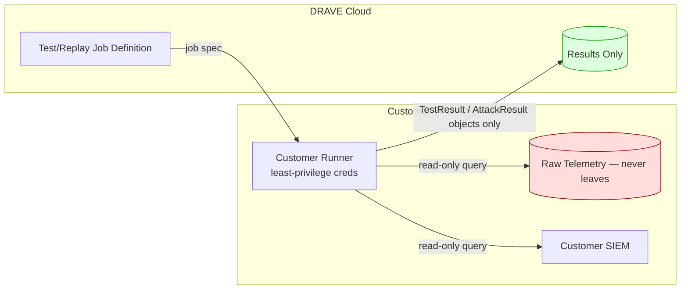
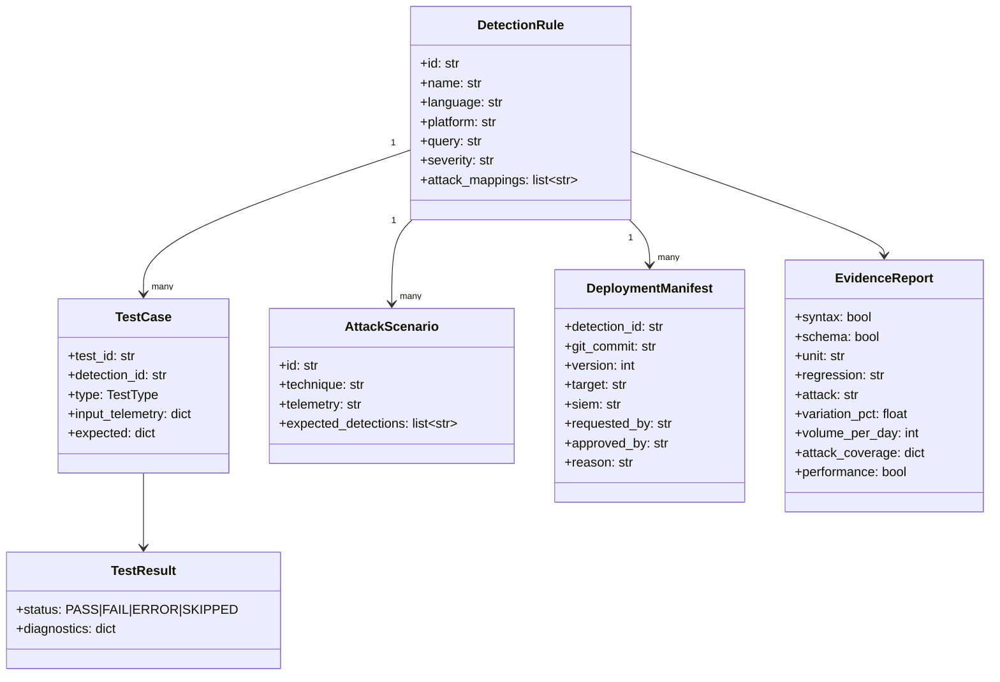
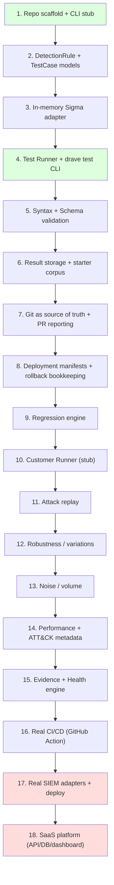

# DRAVE — Architecture Reference

**Purpose:** single source-of-truth diagram set for DRAVE's system architecture, data model, lifecycle, and trust boundaries. Give this file to an AI coding agent alongside `AGENTS.md` and `DRAVE-Approval-Policy.md` — it's the "shape of the system" doc; those are the "rules of engagement" docs.

Companion docs: `DRAVE-Knowledge-Base.md` (concepts), `DRAVE-Build-Blueprint.md` (build order/tech stack), `AGENTS.md` + `DRAVE-Approval-Policy.md` (agent behavior rules).

---

## 1. System Architecture (Component View)



**Key boundary:** everything inside `RUNNER` down runs inside **customer infrastructure**. Only results (not raw telemetry) cross back to DRAVE Cloud — see Section 4.

---

## 2. DRAVE Core — Three Pillars, One Object



This maps directly to `core/` in the repo:

```
core/
├── detection/     ─┐
├── validation/     ├─ ANALYSIS
├── telemetry/      ┘
├── regression/     ─┐
├── replay/          ├─ EVALUATION
├── robustness/       │
├── volume/           │
├── performance/     ┘
└── scoring/          ─ EVIDENCE + HEALTH (aggregates all three)
```
*(Git/versioning logic lives outside `core/detection`, directly against the repo — see Section 3.)*

---

## 3. Detection Lifecycle (End-to-End)



---

## 4. Trust Boundary — Customer Telemetry



**Rule for any agent building this:** if a code path would send raw telemetry (not a `TestResult`/`AttackResult` object) from `runner/` back to `api/`, that is a Tier 3 action under the Approval Policy — stop and ask.

---

## 5. Data Model (Core Objects)



---

## 6. Build-Order Overlay (which layer to build when)


Green = safe to build/run entirely locally. Red = touches real production systems — governed by `DRAVE-Approval-Policy.md` Tier 3.

---

## 7. How to Use This File With an AI Agent

Give the agent, in this order:
1. `AGENTS.md` — how to behave, setup commands, code style
2. `DRAVE-Approval-Policy.md` — what it may/may not do without asking
3. `ARCHITECTURE.md` (this file) — the shape of the system it's building
4. `DRAVE-Build-Blueprint.md` — step-by-step build instructions with tools/libraries
5. `DRAVE-Knowledge-Base.md` — full conceptual reference if it needs "why" context

The diagrams here are Mermaid (plain text) specifically so an agent can read the file directly without image parsing — but they also render as visuals on GitHub, GitLab, and most markdown viewers.
